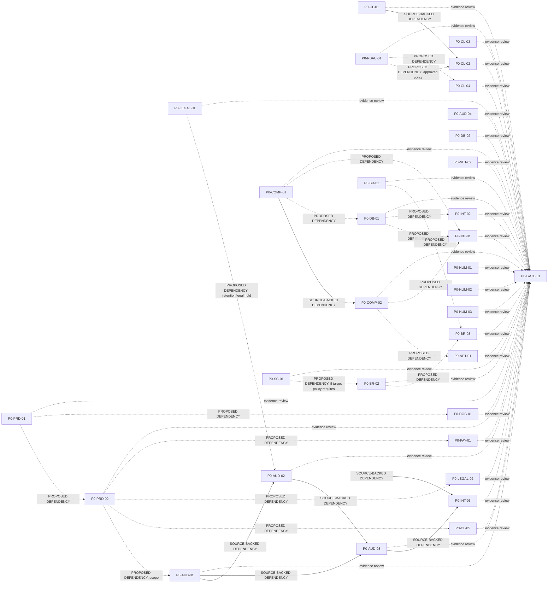

# ماتریس اجرایی وابستگی‌محور Phase 0 — سند نسخه‌پذیر

**نسخه:** 1.0
**ماهیت:** برنامه‌ریزی و بازبینی؛ نه مجوز اجرا
**وضعیت Gate بر مبنای منبع:** `Phase 0 = BLOCKED`؛ `Phase 1 = NOT STARTED`
**ClinicalGuard:** باید `DENY-BY-DEFAULT` بماند.

## 1. دامنه، منابع و قواعد برچسب‌گذاری

منبع مرجع شناسه و status هر P0، جدول بخش ۴ `docs/phase0-final-readiness-report-fa.md` است. سایر منابع مورد بررسی عبارت‌اند از `docs/phase0-readiness-fa.md`، `docs/phase0-gate-review-fa.md`، `docs/audit-unified-approval-package-fa.md` و گزارش‌های تخصصی Security، DBA، Privacy/Legal، Clinical و Product. این سند تصمیم انسانی یا evidence جدید ایجاد نمی‌کند.

برچسب‌ها:

- **`SOURCE-BACKED DEPENDENCY`**: رابطه‌ای که منبع اصلی در ستون dependency صریحاً برای P0ها آورده است. پیکان همواره از پیش‌نیاز به کار وابسته است.
- **`PROPOSED DEPENDENCY`**: ترتیب یا رابطهٔ منطقی پیشنهادی که در منبع به‌عنوان وابستگی رسمی تثبیت نشده است.
- **`OPEN`**: تصمیم، داده، scope، معیار یا مرجعی که تکمیل نشده؛ مقدار آن حدس زده نمی‌شود.
- **`UNASSIGNED`**: شخص صاحب اختیار/Accountable/Approver که در منبع به‌طور معتبر تعیین نشده است.
- **`PASS محدود`**: فقط نتیجه‌ای معتبر در scope/version/محیط ثبت‌شده؛ نه قبولی کامل شرط و نه Phase 0.

**قاعدهٔ Gate:** یال از هر P0 به `P0-GATE-01` فقط به‌معنای ارائهٔ evidence برای بازبینی است، نه پیش‌نیاز اجرای آن P0. استثنا از شرط فقط وقتی قابل بررسی است که رسمی، مستند، محدود به scope، دارای مسئول/ریسک مشخص و با تأیید صاحب اختیار همان حوزه باشد؛ توضیح در سند یا تغییر صوری status به‌تنهایی کافی نیست.

## 2. ماتریس کامل ۳۳ شرط P0

در ستون «مسئول پیشنهادی» نقش اجرایی احتمالی آمده، نه انتصاب. برای هر ردیف دقیقاً یک جایگاه A وجود دارد؛ **A مصوب در تمام ردیف‌ها `UNASSIGNED` است** تا انتصاب معتبر. Approver نقش تأییدکننده است و با R، A یا C یکی نیست.

| P0 ID / وضعیت منبع | اقدام و نوع کار | مسئول پیشنهادی (R) | A مصوب | A پیشنهادی، غیرمصوب | Approver پیشنهادی؛ شخص `UNASSIGNED` | وابستگی‌ها و منبع | خروجی/مدرک | معیار پذیرش | شرط شروع | شرط پایان |
|---|---|---|---|---|---|---|---|---|---|---|
| **P0-PRD-01 — OPEN** | تطبیق نیازمندی‌های مصوب و traceable؛ مستندسازی/تصمیم | مالک محصول | `UNASSIGNED` | مالک محصول | مالک محصول | مرجع مستقل پاسخ‌های ۱–۸۲: `OPEN`؛ وابستگی P0 صریح ندارد | baseline و ماتریس requirement→acceptance→evidence | تمام الزام‌های ادعاشده به منبع/معیار وصل باشند؛ مرجع ناقص یا تعارض حل‌نشده = شکست | دسترسی به مرجع و scope مشخص | review پوشش؛ در نبود مرجع موردنیاز، `OPEN` بماند |
| **P0-PRD-02 — OPEN** | بستن OPENهای محصول بدون حدس؛ تصمیم انسانی/مستندسازی | مالک محصول و owner هر موضوع | `UNASSIGNED` | مالک محصول برای گردآوری | صاحب اختیار هر حوزه، جداگانه | P0 منبعی صریح ندارد؛ استفاده از PRD-01 به‌عنوان پیش‌نیاز کامل `PROPOSED DEPENDENCY` | تصمیم نسخه‌دار، scope، دلیل و owner هر مورد | تمام OPENها تصمیم معتبر یا خروج scope پذیرفته‌شده داشته باشند | فهرست OPEN و اختیار تصمیم‌گیرها مشخص شود | ثبت تصمیم‌های معتبر؛ موارد حل‌نشده باز بمانند |
| **P0-DOC-01 — BLOCKED** | هم‌ترازی اسناد API/Security/Phase 0 با وضعیت واقعی؛ مستندسازی | مالک اسناد و فنی | `UNASSIGNED` | مالک اسناد | Security و مالک سند | پیش‌نیازهای متنی منبع: PRD، Guard، Audit review؛ شناسهٔ P0: `PROPOSED DEPENDENCY` | اسناد جاری سازگار یا برچسب تاریخی/non-authoritative؛ پیوند ادعا به مدرک | هیچ ادعای تاریخی/بی‌مدرک به‌عنوان وضعیت جاری عرضه نشود | baseline و مجوز مستندسازی | review حوزه‌ها؛ سند به‌تنهایی کنترل اجرایی را نمی‌بندد |
| **P0-CL-01 — PASS محدود** | حفظ deny-by-default؛ کنترل/بازبینی منفی | فنی/QA | `UNASSIGNED` | Security owner | Clinical + Security | پیش‌نیاز منبعی برای CL-02؛ **SOURCE-BACKED DEPENDENCY:** CL-01→CL-02 | evidence منفی موجود در منبع و ثبت حفظ Guard | فقط رد درخواست غیرمجاز در scope آزموده‌شده؛ دسترسی مثبت از آن نتیجه نمی‌شود | فقط review/آزمون منفی با مجوز | پذیرش محدود به کنترل deny؛ هر تغییر Guard نیازمند approval و Gate جدید |
| **P0-CL-02 — BLOCKED** | تعریف/اثبات دسترسی مثبت مبتنی بر assignment؛ policy، design، اجرا و آزمون پس از مجوز | فنی/QA | `UNASSIGNED` | مالک محصول برای scope | Clinical + Security | **SOURCE-BACKED DEPENDENCY:** CL-01، RBAC-01، Audit؛ assignment policy نیز پیش‌نیاز متنی منبع است | source-of-truth، lifecycle، scope CRUD/multi-care و evidence enforcement/test | فقط دسترسی/عملیات مصوب؛ مثبت‌تست پیش از approval = شکست | policy و approvals؛ مجوز کد و آزمون جداگانه | شواهد مجاز مثبت/منفی و تأییدهای لازم؛ تا آن زمان Guard بسته |
| **P0-CL-03 — BLOCKED** | revoke دسترسی پس از تغییر assignment؛ طراحی، پیاده‌سازی و آزمون آینده | فنی/QA | `UNASSIGNED` | مالک policy assignment | Clinical + Security | منبع: assignment policy؛ شناسهٔ P0 معین نشده. اتصال به CL-02/AUD-01 **PROPOSED DEPENDENCY** | inventory مسیر session/token/cache/API؛ آزمون revoke و Audit event | inventory/endpoint/token/cache/lifecycle در منبع کامل نیست: `OPEN`; هیچ threshold تازه‌ای تعیین نمی‌شود | policy مصوب، inventory معتبر، مجوز کد/DB/Runtime Test حسب scope | همهٔ مسیرهای مصوب پس از revoke رد و evidence قابل‌راستی‌آزمایی باشد |
| **P0-CL-04 — BLOCKED** | تعریف و اثبات emergency access، علت/انقضا/review؛ تصمیم، design و آزمون آینده | فنی/QA | `UNASSIGNED` | Clinical owner | Clinical + Security + Privacy | متن منبع: identity/role mapping و Audit design؛ رابطه با RBAC/AUD-01 **PROPOSED DEPENDENCY** | policy، مسیر مجاز/مردود و رویداد synthetic | فقط actor/علت/مدت و رویداد مصوب؛ هیچ استنباط از موارد SUPERSEDED | صاحب اختیار و policy تعیین شوند | approvals و evidence سناریوهای مصوب؛ تا آن زمان دسترسی بسته |
| **P0-CL-05 — OPEN** | تعیین scope مدیر و فیلدهای summary؛ تصمیم انسانی/design | Product + Clinical | `UNASSIGNED` | مالک محصول | Clinical + Security؛ Privacy/Legal حسب داده | منبع متنی: حقوق/حریم خصوصی؛ شناسهٔ P0 پیش‌نیاز مصوب ندارد | فهرست فیلد و role/data/action matrix | فقط فیلد و scope امضاشده؛ unresolved scope = شکست | گزینه‌ها و صاحبان اختیار مشخص | تصمیم/approval حوزه‌ای ثبت شود |
| **P0-LEGAL-01 — BLOCKED** | تصویب retention/deletion/legal hold؛ تصمیم/design/آزمون | Legal/Privacy | `UNASSIGNED` | Legal owner | Legal + Privacy؛ Clinical حسب پرونده | متن منبع: retention rules و data inventory؛ رابطه به AUD-02/03 **PROPOSED DEPENDENCY** | policy دسته‌محور، مبنا/مدت/استثنا و آزمون synthetic | همهٔ کپی‌ها/backup/hold در scope policy پوشش یابند؛ مدت نامصوب = شکست | صاحبان اختیار و inventory داده | امضای معتبر و evidence رفتار؛ تا آن زمان deletion خودکار خاموش طبق منبع |
| **P0-LEGAL-02 — OPEN** | consent/guardian، متن/نسخه/مدرک/withdrawal؛ تصمیم/design/approval | Product/فنی | `UNASSIGNED` | Legal owner | Legal + Privacy | منبع متنی: فرم/identity flow؛ dependency P0 صریح نیست | policy و workflow تأییدشده و آزمون synthetic | مبنای قانونی، سن/صلاحیت، version و withdrawal تعیین شده باشد | Legal/Privacy owner و scope معلوم | approval و evidence جریان؛ بدون آن OPEN |
| **P0-RBAC-01 — BLOCKED** | least privilege، scope، جداسازی وظایف و جلوگیری از escalation؛ design/اجرا/آزمون آینده | Security/فنی | `UNASSIGNED` | Security owner | Security؛ Product/Clinical برای scope | متن منبع: policy نهایی و assignment؛ P0های وابسته در منبع CL-02 ذکر می‌شود | ماتریس role/resource/action و آزمون‌های مجاز | هیچ نقش/ترکیب نقشی از policy تجاوز نکند | policy نهایی، owner و مجوزها | evidence enforcement/review کامل |
| **P0-AUD-01 — BLOCKED** | Event Catalog، coverage و failure/alert policy؛ design/تصمیم | Security + Clinical + Privacy | `UNASSIGNED` | Security owner | Security و صاحبان داده | متن منبع: event scope/retention؛ اتصال پیش از implementation **PROPOSED DEPENDENCY** | catalog و trace به مسیرها | رویدادهای مصوب در scope پوشش یابند؛ فیلد/مسیر نامعلوم `OPEN` | scope و minimization با صاحبان داده تعیین شود | catalog تأییدشده و evidence coverage |
| **P0-AUD-02 — BLOCKED** | حفاظت Audit از cascade/drop و lifecycle؛ design، DB، آزمون و approval | Security + DB owner | `UNASSIGNED` | DB owner | Security + Legal + DB owner | **SOURCE-BACKED DEPENDENCY:** AUD-01، retention policy (retention متن policy است نه P0 مستقل). ارتباط به DB-02 در سطح مراحل **PROPOSED DEPENDENCY** | طراحی lifecycle، FK/cascade/migration review و سناریوهای synthetic آینده | parent delete/rollback مطابق policy و تاریخچهٔ لازم محفوظ؛ runtime test لازم | inventory/design و مجوز DB/Migration/Runtime Test جدا | همهٔ سناریوهای مصوب آزموده و approvals ثبت شوند |
| **P0-AUD-03 — NOT TESTED** | threat model، گزینه‌های tamper evidence، key custody و verifier؛ design/آزمون آینده | Security + Platform/DBA | `UNASSIGNED` | Security owner | Security؛ Privacy/Legal برای WORM/retention | **SOURCE-BACKED DEPENDENCY:** AUD-01/02؛ vendor review متن منبع | Threat Model، design و گزارش آزمون synthetic verifier | فقط سناریوهای مصوب/آزموده ادعا شوند؛ الگوریتم در منبع OPEN | Threat Model و مجوز طراحی؛ آزمون پس از approval | verifier evidence و sign-off معتبر |
| **P0-AUD-04 — BLOCKED** | رفع شکاف تاریخچه/actor و تفکیک Audit از operational history؛ design/DB/آزمون | Security + مالکان سیستم | `UNASSIGNED` | مالک سیستم مربوط | Security و owner داده | متن منبع: schema/runtime review؛ وابستگی P0 مصوب صریح ندارد | schema/event inventory و آزمون actor/change/delete | تاریخچه و actor attribution مطابق policy؛ موارد cascade/mutable حل شوند | inventory و مجوز review/آزمون | evidence synthetic و sign-off |
| **P0-DB-01 — PASS محدود** | migration/health در نسخهٔ هدف؛ تکمیل matrix آینده | DB owner + QA | `UNASSIGNED` | DB owner | DB owner | **SOURCE-BACKED DEPENDENCY:** Compose/environment | versions/config، logs، migration/health matrix | فقط نسخه/محیط آزموده‌شده؛ پوشش target matrix هنوز لازم | target و محیط مجاز | matrix کامل؛ PASS محدود فعلی کامل تلقی نشود |
| **P0-DB-02 — BLOCKED** | FK/cascade/delete/rollback review و آزمون synthetic آینده | DBA + QA | `UNASSIGNED` | DB owner | DBA + Security + Legal | متن منبع: Audit design؛ پیوند به AUD-02 در سطح مرحله **PROPOSED DEPENDENCY**؛ چرخه با مرحله‌های تفکیک‌شده حل می‌شود | FK inventory، privilege evidence، delete/rollback/restore logs | اثرهای schema و rollback در scope مصوب ایمن و آزموده باشند | inventory با مجوز؛ Runtime Test/DB مجوز جدا | آزمون‌های مصوب و sign-off |
| **P0-COMP-01 — NOT TESTED** | Compose config/build/start/health در میزبان مجاز | Platform operator + QA | `UNASSIGNED` | Platform owner | Platform owner | **SOURCE-BACKED DEPENDENCY:** Docker host/images (شرط محیط، نه P0)؛ پیوند به INT-01 **PROPOSED DEPENDENCY** | config/build/start output، image/service versions، logs، health و exit codes | service inventory، target versions و health thresholds منبع نهایی `OPEN`; تعریف config به‌تنهایی PASS نیست | Docker مجاز، مجوز زیرساخت و Runtime Test | اجرای کامل در محیط غیرتولیدی و evidence قابل‌بازتولید |
| **P0-COMP-02 — NOT TESTED** | inspect network/ports/mounts/tmpfs/cleanup در Compose | Platform + Security/QA | `UNASSIGNED` | Platform owner | Platform + Security | **SOURCE-BACKED DEPENDENCY:** COMP-01 | inspect network/port/mount/tmpfs و cleanup evidence | مقادیر دقیق config مصوب لازم؛ published port ناخواسته یا cleanup ناقص = شکست؛ thresholds در منبع `OPEN` | COMP-01 و مجوز runtime/infrastructure | inspect واقعی و اثبات cleanup؛ YAML کافی نیست |
| **P0-NET-01 — PASS محدود** | حفظ scope و اثبات egress در boundary هدف | Security + Platform | `UNASSIGNED` | Security owner | Security + Platform | **SOURCE-BACKED DEPENDENCY:** Docker Compose | probe logs در boundary مصوب | فقط همان probes/boundary؛ namespace PASS به host تعمیم نمی‌یابد | Compose/boundary و مجوز آزمون | evidence boundary target؛ PASS محدود فعلی حفظ شود |
| **P0-NET-02 — BLOCKED** | دریافت policy/evidence egress host/provider | Platform/Arena owner | `UNASSIGNED` | Platform/Arena owner | Security + Platform | **SOURCE-BACKED DEPENDENCY:** policy host/provider | policy و evidence upstream با scope | فقط دامنه‌ای که evidence پوشش می‌دهد؛ تغییر firewall بدون مجوز شکست | owner و مجوز review | evidence معتبر و تأیید scope |
| **P0-SC-01 — BLOCKED** | verification مستقل provenance/signature/hash و risk acceptance | Supply-chain Security + DBA | `UNASSIGNED` | Security owner | Security + DB owner | متن منبع: artifact evidence/registry/repo؛ اتصال به BR-02 فقط اگر معیار نسخه الزام کند: **PROPOSED DEPENDENCY** | provenance/signature/hash verification و risk record | منشأ در scope قابل‌تأیید و ریسک نسخه صریحاً پذیرفته | artifacts و مجوز review | verification مستقل و approval |
| **P0-BR-01 — PASS محدود** | نگهداری/تأیید شواهد synthetic PG16.2 و تعیین scope هدف | DBA + QA | `UNASSIGNED` | DB owner | DB owner | متن منبع: scope acceptance | artifact/version/hash/restore verification | فقط PG16.2 و synthetic؛ نه production یا DR | criteria target و مجوز review | scope پذیرفته؛ هر تعمیم نیازمند آزمون جدا |
| **P0-BR-02 — PASS محدود** | تعیین policy نسخهٔ client/server و scope restore PG17.12 | DBA + QA | `UNASSIGNED` | DB owner | DB owner/معیارپذیر | **SOURCE-BACKED DEPENDENCY:** supply-chain و target policy؛ وابستگی کاری SC-01→BR-02 **PROPOSED DEPENDENCY** در صورت الزام provenance | شواهد server PG17.12 + client 18.7 و restore | نباید client 18.7 را client PG17 معرفی کرد؛ نتیجه محدود به نسخه‌های ثبت‌شده | policy نسخه و مجوز آزمون/review | target policy و evidence لازم پذیرفته شود |
| **P0-BR-03 — NOT TESTED** | تعیین RPO/RTO، storage/keys/runbook و recovery drill | Platform + DBA | `UNASSIGNED` | business owner | Security + business owner | متن منبع: storage و credentials مصوب؛ ارتباط BR-01/02 به drill **PROPOSED DEPENDENCY** | اهداف مصوب و drill report با زمان، versions، integrity evidence | RPO/RTO فعلی و معیار موفقیت `OPEN`; فقط اهداف تأییدشده معیارند | owner هدف، مجوز environment/keys | اندازه‌گیری و تحقق اهداف مصوب؛ approval نتیجه |
| **P0-INT-01 — BLOCKED** | full integration acceptance روی DB/Compose target و mocks | QA + DB owner | `UNASSIGNED` | QA lead | QA + DB owner | **SOURCE-BACKED DEPENDENCY:** Compose، migration | allowlist suites، DB/version، synthetic fixtures، logs/exit codes | فهرست دقیق suiteهای الزامی و target DB در منابع `OPEN`; PGlite/native runs قبلی جای acceptance کامل نیست | محیط معتبر، allowlist و مجوز Runtime Test | همهٔ suiteهای مصوب در target اجرا و review شوند |
| **P0-INT-02 — NOT TESTED** | browser/refund روی DB هدف و localeهای لازم، فقط mock تا مجوزهای بعدی | QA | `UNASSIGNED` | QA lead | QA + Finance | **SOURCE-BACKED DEPENDENCY:** DB/locale و approvals (متن منبع)؛ وابستگی PAY-01↔INT-02 تفکیک مرحله‌ای **PROPOSED DEPENDENCY** | browser trace/log، DB/version/locale و mock evidence | locale/flow هدف `OPEN`; Chromium+PGlite نتیجهٔ native DB نیست | flow/locale و مجوز QA؛ mock-only | شواهد target و approval؛ هیچ سرویس واقعی در این برنامه |
| **P0-INT-03 — NOT TESTED** | synthetic cascade/role/migration/restore/Audit tests | DBA + Security + QA | `UNASSIGNED` | Security owner | Security + DB owner | **SOURCE-BACKED DEPENDENCY:** AUD-02/03 | scenario-by-scenario input/output/logs و verifier result | سناریوها/versions/tools در منبع جزئی نشده و `OPEN`; فقط سناریوهای مصوب | طرح Audit، مجوز Runtime/DB Test، synthetic-only | همهٔ سناریوهای مصوب pass و sign-off؛ دادهٔ واقعی ممنوع |
| **P0-PAY-01 — BLOCKED** | policy مالی و approvals؛ Phase 0 فقط mock | Finance + QA/فنی | `UNASSIGNED` | Finance owner | Finance + Legal + Security مستقل | متن منبع: vendor, credentials, policy؛ رابطهٔ mock با INT-02 **PROPOSED DEPENDENCY** | policy signed و mock evidence | پرداخت واقعی در Phase 0 ممنوع طبق منبع؛ mock با واقعی یکی نیست | policy و مجوز mock؛ provider واقعی مجوز جدا می‌خواهد | approvals و evidence mock؛ external test خارج از این برنامه |
| **P0-HUM-01 — BLOCKED** | تعیین صاحب اختیار بالینی و ثبت approval | مالک محصول برای governance | `UNASSIGNED` | مالک محصول فقط برای تعیین فرایند | مسئول بالینی واقعی `UNASSIGNED` | متن منبع: clinic governance | اختیار، نام، scope/version/date و امضا | فقط approval قابل‌تأیید صاحب اختیار؛ تصمیم محصول جایگزین نیست | تعیین رسمی مسئول | امضای معتبر ثبت شود |
| **P0-HUM-02 — BLOCKED** | تعیین مسئولین و ثبت Security/Privacy approval مستقل | Security/Privacy owners | `UNASSIGNED` | Security owner فقط برای گردآوری | Security و Privacy جداگانه `UNASSIGNED` | متن منبع: Audit/RBAC/network design | review evidence و امضای هر حوزه | نام/اختیار/scope/date معتبر؛ review مشروط یا بی‌نام کافی نیست | تعیین owner و evidence bundle | هر دو تأیید مستقل و معتبر |
| **P0-HUM-03 — BLOCKED** | جمع‌آوری Legal/Finance/Platform approvals تفکیک‌شده | مالکان حوزه‌ای | `UNASSIGNED` | مالک محصول فقط برای گردآوری Gate package | Legal، Finance، Platform owners مستقل | متن منبع: شروط مربوطه | امضای حوزه‌ای و risk acceptance | هر حوزه فقط خودش را تأیید کند؛ امضای کلی مبهم شکست است | owner و evidence هر حوزه | همهٔ approvalهای مربوط معتبر باشند |
| **P0-GATE-01 — BLOCKED** | evidence review و تصمیم رسمی Gate | evidence owner/QA | `UNASSIGNED` | Gate owner پیشنهادی؛ انتصاب نشده | تمام Approverهای لازم، مستقل | **SOURCE-BACKED DEPENDENCY:** همهٔ شروط P0 طبق منبع | bundle traceable، statuses، approvals و decision record | هر OPEN/BLOCKED/NOT TESTED/UNVERIFIED، scope ناکافی یا approval مفقود مانع است، مگر استثنای رسمی معتبر؛ هیچ تغییر status صوری | evidence bundle و Gate owner/approvers معلوم باشند | تصمیم انسانی رسمی و ثبت‌شده؛ نه به‌طور خودکار READY/COMPLETE |

## 3. RACI تفکیک‌شده

**قاعدهٔ مصوب در این سند:** برای هر P0 یک جایگاه A وجود دارد، اما **A واقعی/مصوب برای همه `UNASSIGNED`** است. نقش‌های «A پیشنهادی» جدول بالا پیشنهاد تخصیص‌اند، نه انتصاب یا authority. R اجرای کار را می‌کند؛ A پاسخ‌گوست؛ Approver اختیار تأیید scope خودش را دارد؛ Consulted نظر می‌دهد و Informed گزارش دریافت می‌کند. هیچ‌کدام قابل‌جایگزینی با دیگری نیستند.

| حوزهٔ کاری | R پیشنهادی | A مصوب | A پیشنهادی، غیرمصوب | Approver مستقل | Consulted | Informed |
|---|---|---|---|---|---|---|
| PRD/scope | Product owner | `UNASSIGNED` | Product owner | صاحب اختیار محصول، `UNASSIGNED` | فنی، مالی، حوزه‌های متأثر | QA, Gate |
| مستندات | مالک اسناد + فنی | `UNASSIGNED` | مالک اسناد | Security/owner سند، `UNASSIGNED` | Product, Clinical | QA, Gate |
| بالینی | فنی/QA پس از مجوز | `UNASSIGNED` | Clinical owner برای policy؛ هنوز تعیین نشده | Clinical + Security؛ Privacy حسب داده | Product, DB | QA, Gate |
| Legal/Privacy | Legal/Privacy | `UNASSIGNED` | Legal owner | Legal + Privacy مستقل | Security, Clinical, Platform | Product, QA, Gate |
| RBAC/Audit/Security | Security + فنی + DBA حسب کار | `UNASSIGNED` | Security owner | Security؛ حوزه‌های داده برای scope خود | Clinical, Privacy, Product | QA, Gate |
| DB/Migration | DBA + QA | `UNASSIGNED` | DB owner | DB owner + Security/Legal حسب اثر | Clinical, Platform | Gate |
| Compose/Network | Platform operator + QA | `UNASSIGNED` | Platform owner | Platform + Security | DB owner | Product, Gate |
| Supply chain | Security/Supply-chain + DBA | `UNASSIGNED` | Security owner | Security + DB owner | Platform | QA, Gate |
| Backup/DR | Platform/DBA | `UNASSIGNED` | business owner برای اهداف | Security + business owner | Legal, QA | Product, Gate |
| Integration/Browser | QA + DB owner/فنی | `UNASSIGNED` | QA lead | QA + DB owner؛ Finance برای Browser/Refund | Security, Product | Gate |
| Payments | Finance + QA/فنی | `UNASSIGNED` | Finance owner | Finance + Legal + Security مستقل | Product | QA, Gate |
| Gate | evidence owner/QA | `UNASSIGNED` | Gate owner | همهٔ صاحبان اختیار لازم | مالکان همهٔ P0 | ذی‌نفعان |

در تعارض تأییدها، کار مربوط متوقف می‌ماند تا صاحب اختیار و فرایند حل تعارض تعیین شوند. منابع بررسی‌شده مسیر حل تعارض مشخصی تثبیت نمی‌کنند؛ آن موضوع `OPEN` است. سکوت، نقش Consulted یا یک امضای بین‌حوزه‌ای تأیید تلقی نمی‌شود.

## 4. گراف وابستگی و فعالیت‌های پیشنهادی

### 4.1 گراف P0

جهت یال‌های وابستگی: **پیش‌نیاز → کار وابسته**. پیکان‌های P0 به Gate فقط **evidence review** هستند. یال‌های `SOURCE-BACKED DEPENDENCY` از dependencyهای صریح بخش ۴ گزارش اصلی گرفته شده‌اند؛ هر یال کاری دیگر در این گراف `PROPOSED DEPENDENCY` است.

گراف شامل هر ۳۳ شناسه است و هر کدام مسیر مستقیم evidence review به Gate دارد. هیچ چرخهٔ P0 در گراف وجود ندارد؛ دو وابستگی چرخه‌ساز بالقوه به نمودار مرحله‌ای جدا منتقل شده‌اند. روابط خط‌چین مصوبه نیستند.

### 4.2 فعالیت‌های مستقل پیشنهادی AUD/DB

این‌ها گام‌های برنامه‌ریزی پیشنهادی‌اند، نه P0های جدید و نه statusهای تازه.

| فعالیت | ورودی | خروجی | شرط شروع | شرط پایان | مجوز لازم | تصویب |
|---|---|---|---|---|---|---|
| `DB-02a` — inventory ایستای DB | مجوز review و schema/migration قابل‌بررسی | inventory FK/cascade/rollback مشاهده‌شده | scope و دسترسی مجاز معلوم | inventory منبع‌دار آمادهٔ design شود | مجوز review مستندات/DB؛ بدون تغییر | `PROPOSED — NOT APPROVED` |
| `AUD-02a` — design lifecycle | inventory DB-02a، event scope و retention | گزینه‌های delete/cascade/migration/lifecycle | ورودی DB-02a و تصمیم‌های حوزه‌ای موجود | design برای review؛ نه پیاده‌سازی | مجوز طراحی؛ approval Security/Legal/DB لازم | `PROPOSED — NOT APPROVED` |
| `DB-02b/AUD-02b` — آزمون اعتبارسنجی آینده | design تأییدشده، سناریو و DB غیرتولیدی | logs آزمون synthetic و sign-off | مجوز DB/Migration و Runtime Test مجزا، دادهٔ مصنوعی | تمام سناریوهای مصوب evidence داشته باشند | مجوزهای مستقل DB، زیرساخت و Runtime Test | `NOT AUTHORIZED` در این برنامه |

وابستگی مرحله‌ای پیشنهادی: `DB-02a → AUD-02a → DB-02b/AUD-02b`. به این ترتیب چرخهٔ مبهم در سطح P0 حذف نمی‌شود؛ بلکه به ترتیب کار پیشنهادی آشکار و قابل‌تصمیم تبدیل می‌شود. این ترتیب هنوز مصوب نیست.

### 4.3 فعالیت‌های مستقل پیشنهادی PAY/INT

| فعالیت | ورودی | خروجی | شرط شروع | شرط پایان | مجوز لازم | تصویب |
|---|---|---|---|---|---|---|
| `INT-02-MOCK` — آزمون mock-only آینده | جریان/locale و mock boundary مصوب، دادهٔ synthetic | شواهد browser/refund mock | مجوز QA؛ تأیید عدم تماس با provider/پرداخت واقعی | evidence محدود به mock و target واقعی آزموده‌شده | Runtime Test مجزا؛ هیچ مجوز پرداخت واقعی ندارد | پیشنهاد برنامه‌ریزی؛ هنوز مجاز نشده |
| `PAY-01-POLICY` — تصمیم سیاست مالی | نیازمندی محصول؛ شواهد mock فقط در صورت پذیرش owner | policy و تصمیم نسخه‌دار | Finance/Legal/Security owner تعیین شده | approvals مستقل ثبت شوند | مجوز تصمیم محصول/تخصصی؛ سرویس خارجی مجوز جدا | `OPEN` تا تصمیم صاحب اختیار |
| `INT-02-FUTURE` — آزمون احتمالی بعدی | policy و مجوزهای معتبر؛ محیط/DB/locale هدف | آزمون کنترل‌شده در scope مصوب | approvals لازم و Runtime Test مجزا | نتیجه و logs با معیار مصوب | Runtime Test؛ مجوز external/payment اگر واقعاً لازم باشد، جداگانه | `PROPOSED — NOT AUTHORIZED` |

پیکان پیشنهادی `INT-02-MOCK → PAY-01-POLICY → INT-02-FUTURE` فقط ترتیب احتمالی را نشان می‌دهد. آزمون واقعی provider/payment در این مأموریت مجاز نیست.

## 5. معیارهای OPEN و تصمیم‌های انسانی

موارد زیر در منابع به‌اندازهٔ کافی مشخص نشده‌اند؛ باید `OPEN` بمانند و مقدار ساخته‌شده به آن‌ها نسبت داده نشود:

- **P0-INT-01:** suite allowlist کامل، target DB/version، محیط Compose، fixture مصنوعی و خروجی مورد انتظار. readiness نتایج selected suites را ثبت می‌کند، نه فهرست رسمی کامل پذیرش.
- **P0-CL-03:** endpoint inventory، مسیرهای واقعی session/token/cache، lifecycle و پاسخ مورد انتظار پس از revoke. آزمون مثبت بالینی تا policy و مجوز مربوط ممنوع است.
- **P0-COMP-01:** inventory سرویس‌های لازم، Compose/Engine/image versions، health threshold و معیار build/start؛ Docker runtime در منبع `NOT RUN` است.
- **P0-COMP-02:** network attachments، published ports، mountها، tmpfs values و cleanup criteria؛ همه نیازمند config مصوب و inspect واقعی هستند.
- **P0-INT-03:** سناریوها، role/privilege inventory، ابزار و نسخه، الگوریتم/chain verifier، و مراحل delete/restore. آزمون runtime این ردیف انجام نشده.
- **P0-BR-03:** RPO/RTO و success criteria برای صحت/زمان recovery؛ مالک business باید اهداف را تصویب کند. مقادیر 1h/4h در گزارش به‌عنوان تأییدشده ثبت نشده‌اند.
- **تصمیم‌های انسانی:** انتصاب بالینی، Security/Privacy، Legal، Finance، Platform/DB و Gate؛ policyهای retention/consent/access/emergency؛ scope exceptionها و مسیر تعارض Approverها.
- **مدرک:** هر نتیجه باید به scope، نسخه، محیط، دادهٔ synthetic، مسئول آزمون و بازبین مرتبط باشد. «انجام شد» یا یک سند طراحی، به‌تنهایی evidence پذیرش نیست.

## 6. شناسه‌ها و منشأ

- فقط شناسه‌های P0 جدول اصلی به‌عنوان **P0** استفاده شده‌اند؛ شمارشان ۳۳ است.
- `SEC-01..SEC-10` در گزارش Security آمده‌اند، اما status همان گزارش `OPEN / NOT VERIFIED` است و اطلاعات صاحب اختیار/امضای معتبر کامل نیست.
- `DBA-01..DBA-09` نسبت به گزارش تخصصی DBA `UNVERIFIED REFERENCE` هستند؛ `DBA-FU-01..12` شناسه‌های داخلی پیگیری بسته‌اند، نه شروط رسمی DBA.
- ارجاع‌های `LEG`، `PRV`، `CLIN` و `PROD` نسبت به گزارش‌های تخصصی متناظر تا اثبات منشأ `UNVERIFIED REFERENCE` می‌مانند و نباید شرط رسمی آن گزارش‌ها معرفی شوند.
- `CLN-01` و `CLIN-01` مستقل‌اند؛ این سند آن‌ها را با شناسه‌های P0 مخلوط نمی‌کند.
- پیشنهادهای WORM، Hash Chain، Signed Checkpoint و fail-closed به‌خودی‌خود معماری مصوب یا approval نیستند.

## 7. کنترل statusها و Gate

وضعیت‌های زیر عیناً از جدول بخش ۴ منبع اصلی آمده‌اند:

- **`OPEN` (4):** P0-PRD-01، P0-PRD-02، P0-CL-05، P0-LEGAL-02.
- **`NOT TESTED` (6):** P0-AUD-03، P0-COMP-01، P0-COMP-02، P0-BR-03، P0-INT-02، P0-INT-03.
- **`PASS محدود` (5):** P0-CL-01، P0-DB-01، P0-NET-01، P0-BR-01، P0-BR-02.
- **`BLOCKED` (18):** P0-DOC-01، P0-CL-02، P0-CL-03، P0-CL-04، P0-LEGAL-01، P0-RBAC-01، P0-AUD-01، P0-AUD-02، P0-AUD-04، P0-DB-02، P0-NET-02، P0-SC-01، P0-INT-01، P0-PAY-01، P0-HUM-01، P0-HUM-02، P0-HUM-03، P0-GATE-01.

جمع: 4 + 6 + 5 + 18 = 33. پنج مورد `PASS محدود` کامل نیستند.

**Gate remains blocked** اگر شرطی `BLOCKED`، `NOT TESTED` یا `OPEN` باشد؛ ارجاعی `UNVERIFIED REFERENCE` برای تصمیم لازم مانده باشد؛ دامنهٔ `PASS محدود` نیاز را پوشش ندهد؛ مدرک قابل‌راستی‌آزمایی یا approval صاحب اختیار نباشد. استثنا باید رسمی، مستند، محدود به scope و تأییدشده توسط صاحب اختیار مربوط باشد و status اصلی را صوری عوض نمی‌کند.

این چهار وضعیت مترادف نیستند:

- `READY FOR HUMAN REVIEW`: بستهٔ evidence برای بررسی انسانی آماده است.
- `APPROVED`: صاحب اختیار مشخص تصمیمی در scope مشخص را تأیید کرده است.
- `PASS`: معیار مشخص با evidence کافی در scope پذیرش احراز شده است.
- `PHASE 0 COMPLETE`: نتیجهٔ رسمی Gate پس از تعیین تکلیف شروط و approvals لازم.

هیچ‌کدام به‌تنهایی جانشین دیگری نیست.

## 8. محدودیت‌ها و وضعیت نهایی

این سند برنامه است و مجوز اجرای P0ها نیست. در تهیهٔ آن، کد، تست، DB، migration، زیرساخت، شبکه یا Runtime تغییر/اجرا نشده؛ Docker، آزمون بالینی، سرویس بیرونی و پرداخت واقعی استفاده نشده‌اند. هیچ Commit، Push یا Deploy انجام نشده است. `ClinicalGuard` باید `DENY-BY-DEFAULT` بماند.

`Phase 0 = BLOCKED`
`Phase 1 = NOT STARTED`
`Implementation authorization = NOT GRANTED`
